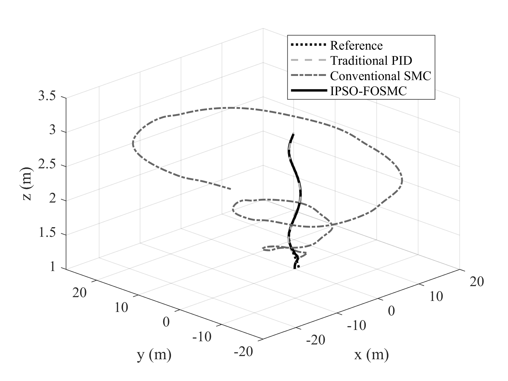
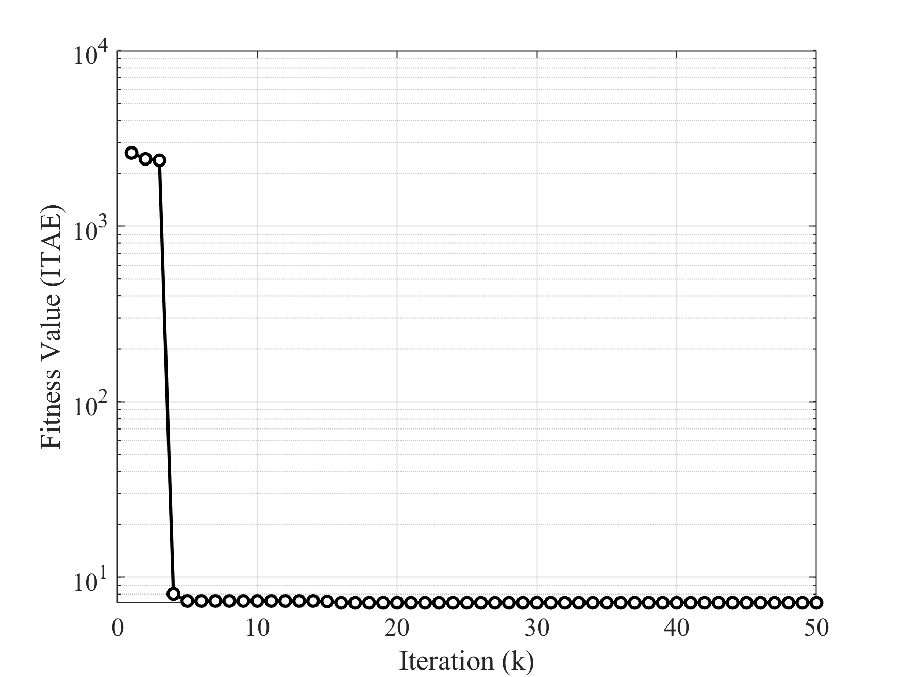
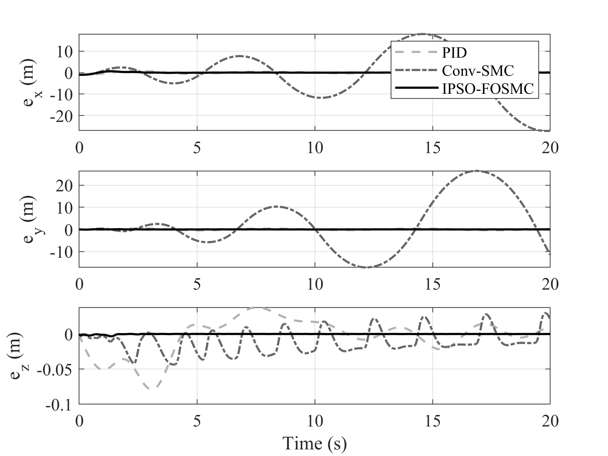
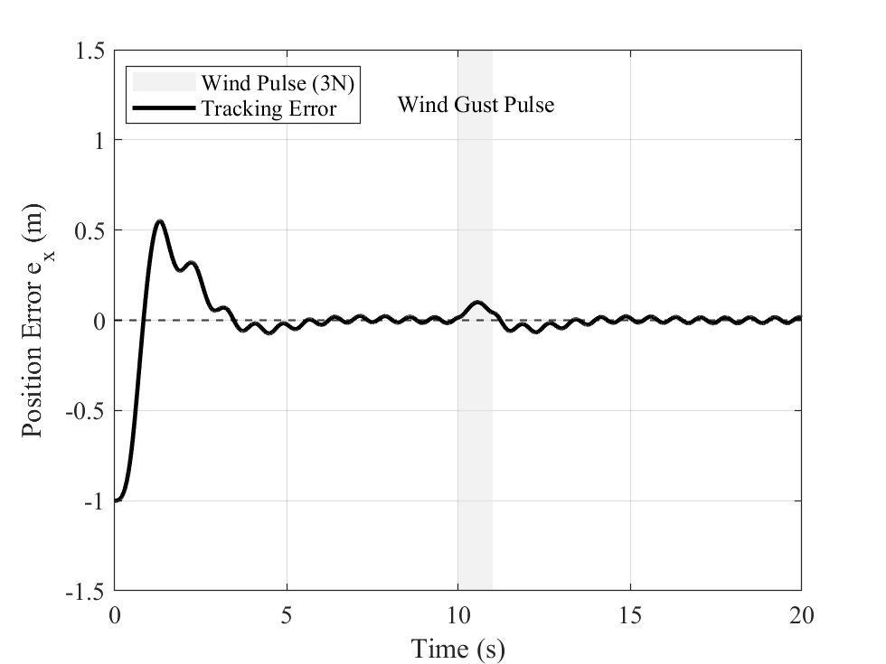

# Quadrotor FOSMC + IPSO

> EI 会议论文（**第一作者**）的仿真复现代码：四旋翼无人机**分数阶滑模轨迹跟踪控制**，控制器参数由**改进粒子群优化（IPSO）**自动整定。
> 对比维度：轨迹误差、收敛速度、姿态波动、抗扰性能。



## 论文信息

| 项 | 内容 |
|---|---|
| 标题 | Fractional-Order Sliding Mode Trajectory Tracking Control of Quadrotor UAVs Based on Improved Particle Swarm Optimization |
| 作者位次 | **第一作者** |
| 类型 | EI 会议论文（已录用，有中外文录用通知） |
| 本项目内容 | 论文中的仿真复现代码、结果图与实验设置 |

> **完整论文 PDF 未随本仓库公开**（版权归出版方）。如需引用请通过 DOI 获取。

## 被控对象模型

`src/quadrotor_system.m` 是一个自包含的四旋翼动力学仿真器：

| 参数 | 取值 |
|---|---|
| 质量 m | 1.2 kg |
| 重力加速度 g | 9.81 m/s² |
| 臂长 l | 0.25 m |
| 转动惯量 Ix / Iy / Iz | 0.011 / 0.011 / 0.022 kg·m² |
| 状态维度 | 12 维（位置 + 姿态 + 速度 + 角速度） |
| 仿真步长 dt / 时长 T | 0.01 s / 20 s |
| 参考轨迹 | 三维螺旋：`x_d = cos(0.5t)`、`y_d = sin(0.5t)`、`z_d = 1 + 0.1t` |
| 物理约束 | 最大倾角饱和 **35°**（模拟真实飞控限制） |
| 性能指标 | **ITAE**（时间加权绝对误差积分） |

**函数签名**：`[ITAE, sim_out] = quadrotor_system(params, ctrl_type, scenario)`

- `params`：待优化的控制器参数（4 维）；
- `ctrl_type`：控制器类型（`'FOSMC'` 分数阶滑模 / 对比控制器）；
- `scenario`：测试场景（`'Normal'` 正常 / 扰动场景）。

## IPSO 参数寻优

`src/main_experiment.m` 实现了 IPSO（改进粒子群优化）：

```matlab
swarm_size = 30;      % 种群规模
max_iter   = 50;      % 迭代次数
dim        = 4;       % 待优化参数维度
lb = [1, 1, 1, 0.1];  % 下界
ub = [15, 15, 15, 0.9];  % 上界
```

三个设计要点：

1. **非线性惯性权重衰减**：`w = 0.9 − 0.5·(t/max_iter)²`
   早期保持较大 `w` 做全局探索，后期快速收敛到局部精修。相比线性衰减，平方项让"探索→开发"的切换更晚、更陡。
2. **学习因子固定为 1.5 / 1.5**（`c1 = c2`），配合权重衰减使用；
3. **边界钳制**：每次更新后 `pos = max(pos, lb); pos = min(pos, ub)`，防止粒子飞出可行域。

适应度函数直接调用 `quadrotor_system` 得到 ITAE，即"用闭环控制性能反推最优控制器参数"。

## 结果

| 图 | 内容 |
|---|---|
| `Figure_3_Convergence.png` | IPSO 适应度收敛曲线 |
| `Figure_4_3D_Tracking.png` | 三维螺旋轨迹跟踪效果 |
| `Figure_5_Errors.png` | 各轴位置误差随时间变化 |
| `Figure_6_Robustness.png` | 扰动条件下的鲁棒性对比 |





## 快速开始

需要 MATLAB（无需额外工具箱，仿真器为纯脚本实现）：

```matlab
cd src
main_experiment        % 运行 IPSO 寻优 + 生成全部对比图
```

> ⚠️ IPSO 寻优需要反复调用动力学仿真（30 粒子 × 50 代），**单次运行约需数分钟**。

## 目录结构

```
.
├── src/
│   ├── main_experiment.m     # IPSO 寻优主脚本 + 图表数据导出
│   └── quadrotor_system.m    # 四旋翼动力学 + 控制器 + 场景仿真
└── figures/                  # 论文中的结果图（PNG）
```

## 我负责的部分

**第一作者**。负责建模推导、控制律设计、IPSO 算法改进与参数寻优、扰动测试与结果分析、论文撰写与审稿意见回复。
